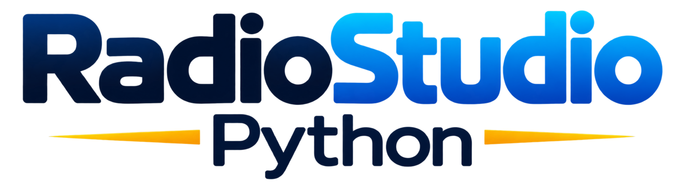

<p align="center">
  
</p>

<h1 align="center">RadioStudio Python Sirius</h1>

<p align="center">
  Automação de áudio para rádio no Windows<br>
  <strong>Playlist · AutoDJ · Entradas ao vivo · Transmissão</strong>
</p>

<p align="center"><a href="LICENSE">Licença MIT</a> · <a href="https://github.com/RaphaaCC/RadioStudio-Python/issues">Reportar um problema</a></p>

---

RadioStudio Python Sirius é um aplicativo independente de automação de áudio, com interface em português. Reúne reprodução local, programação musical e transmissão em uma única estação de trabalho.

## Recursos

| Área | Recursos |
| --- | --- |
| **Playlist e reprodução** | Importe arquivos e pastas, organize a fila, salve listas M3U e controle a reprodução local. |
| **Mixagem** | Ajuste fades e sobreposição de faixas, acompanhe o áudio no ar e visualize capas. |
| **AutoDJ** | Indexe bibliotecas, programe blocos e filtros, evite repetições e consulte o histórico. |
| **Entradas e estúdio** | Use microfone, até cinco auxiliares, Cart wall com 25 botões e agendamento de faixas. |
| **Transmissão** | Use o servidor embutido, Icecast ou SHOUTcast; acompanhe as saídas e os ouvintes quando disponíveis. |
| **Estação** | Configure metadados, título no ar e Rich Presence do Discord. |

## Começar no Windows

1. Instale Python 3 para Windows e confirme que o comando `py` está disponível.
2. Baixe ou clone este repositório.
3. Abra `Iniciar RadioStudio Python.bat`.

O primeiro início cria o ambiente `.venv`, instala as dependências e abre o aplicativo.

### Executar a partir do código

No PowerShell, na pasta do projeto:

```powershell
py -3 -m venv .venv
.\.venv\Scripts\python.exe -m pip install -r requirements.txt
.\.venv\Scripts\python.exe -m radiostudio
```

Para executar os testes automatizados:

```powershell
.\.venv\Scripts\python.exe -m unittest discover -s tests -v
```

## Transmissão

- **Servidor embutido:** o áudio fica disponível em `/live.mp3`; `/status.json` informa o estado do stream.
- **Icecast:** configure um perfil com servidor, porta, mount e usuário de origem.
- **SHOUTcast:** use o modo de fonte v1, compatível com servidores DNAS v2.

A transmissão é codificada em MP3 estéreo a 44,1 kHz. Novos perfis usam 192 kbps por padrão. As senhas ficam no **Gerenciador de Credenciais do Windows**, separadas do arquivo de configurações.

## Dados do usuário

- **Instalação Setup:** `%APPDATA%\RadioStudioPython`.
- **Edição Portable:** pasta `RadioStudioPythonData` ao lado do executável; se ela não permitir gravação, os dados ficam em `%APPDATA%\RadioStudioPython`.

Configurações, bibliotecas e histórico são mantidos no perfil do aplicativo. O [Manual do usuário](radiostudio/assets/manual_usuario.pdf) também está disponível em **Ajuda > Manual do usuário**.

## Limitações conhecidas

- A interface está disponível em português.
- A transmissão usa MP3; o protocolo nativo SHOUTcast v2 ainda não é implementado.
- A reprodução de cada formato depende dos codecs disponíveis no Windows e no FFmpeg incluído.
- Conexões com servidores externos dependem da configuração e do serviço de destino.

## Contribuir

Abra uma [Issue](https://github.com/RaphaaCC/RadioStudio-Python/issues) para relatar problemas ou discutir uma ideia. Pull requests devem explicar a mudança e como foi validada.

Raemi Labs e Raphael Cherfem Carlini mantêm o projeto e decidem o roadmap e quais contribuições entram no repositório principal. Enviar uma sugestão ou pull request não garante sua aceitação.

## Licença e créditos

O código é distribuído sob a [licença MIT](LICENSE). O copyright do projeto é de **Raemi Labs e Raphael Cherfem Carlini**. A MIT permite usar, modificar, redistribuir e criar forks, inclusive para fins comerciais, desde que as cópias e partes substanciais mantenham o aviso de copyright e o texto da licença.

Forks podem seguir em outra direção; as decisões sobre o repositório oficial continuam com seus mantenedores.

## Ajuda

Para suporte, abra uma [Issue no GitHub](https://github.com/RaphaaCC/RadioStudio-Python/issues) ou escreva para [raphael@raemi.xyz](mailto:raphael@raemi.xyz).
